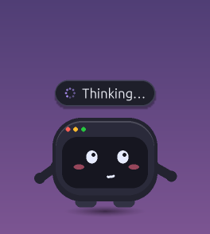
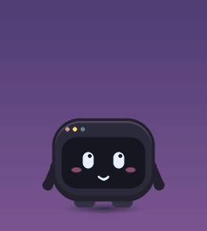

# Clawd Buddy

A tiny animated terminal pet that sits on your taskbar and reacts to [Claude Code](https://claude.ai/code) events. Works on **Windows** and **Linux**.

<!--  -->


## What it does

Clawd Buddy is a small always-on-top character that lives on your taskbar while you work with Claude Code:

| State | What happens |
| --- | --- |
| **Idle** | Breathes, blinks and glances around now and then — your quiet companion |
| **New session begins** (`UserPromptSubmit` hook, first prompt) | Hops and waves hello with happy eyes; a **cyan** "New session" pill floats above its head |
| **Assistant is thinking** (between `UserPromptSubmit` and `Stop`) | Hovers and taps away with a focused look; a **purple** "Thinking…" pill with a spinner |
| **Assistant finishes** (`Stop` hook) | Hops with squash and stretch, arms up, confetti, a short motivational fanfare, and a **green** "Done" pill |
| **Assistant needs permission** (`PermissionRequest` hook) | Bounces and waves with wide eyes, a warm two-note doorbell call, and a **yellow** "Needs input" pill |

The status pill is the buddy's at-a-glance readout, so you can tell what
the assistant is doing without switching windows. With a compositor (Linux)
the buddy also gets a soft ground shadow, a coloured glow while it reacts,
and antialiased edges.

> If multiple signals arrive in quick succession (e.g. a `PermissionRequest`
> while a celebrate is still animating), the buddy now **queues** them
> instead of dropping them — up to three pending reactions play back in
> the order they arrived.
>
> With **several Claude Code sessions** running, each one is tracked from
> its prompt to its own `Stop` (by the hooks' `session_id`). When one
> finishes, the buddy celebrates and then goes back to thinking for the
> others; the pill reads "Thinking ×2" while two are working.

### Settings window

**Right-click the buddy** (or pick **Settings & About…** in the tray
menu, or run `clawd-buddy --settings`) to open one window that
controls everything:

| Page | What's there |
| --- | --- |
| **Buddy** | What the buddy is doing right now (with a chip per working workspace), Celebrate / Bring to front / Center on screen, size, theme, reduce motion, workspace badges, start at login |
| **Sound** | Sound pack (picking one plays a preview), volume, quiet hours with any start and end time |
| **Reminders** | Today's cups and a bar chart of recent days, an **I drank water** button, and the reminder schedule: on/off, how often, when the day starts, sound, overnight pause |
| **Focus** | A pomodoro timer with a live countdown ring: focus and break lengths, Start / Restart / Stop |
| **About** | Version, source link, the settings folder, keyboard shortcuts |

Every change applies to the buddy at once and is saved; there is no
Save button. Changes made elsewhere (the tray menu, Ctrl+1…7) show up
in the window while it's open. It follows your desktop's light or dark
preference. `clawd-buddy --settings focus` opens it on a given page,
and the sidebar's **Quit Clawd Buddy** button asks for a second click
before it closes the buddy.

### Notification sound packs

Pick the audio style from the system-tray right-click menu → **Sound**.
Four packs ship in the box, plus an **Off** entry to mute. Clicking a pack
**previews the celebrate sound immediately** so you can audition options
without waiting for the next event.

| Pack | Celebrate | Wave |
| --- | --- | --- |
| `Fanfare` (default) | Motivational ascending C-major arpeggio that lands on a full triad chord | Warm two-note doorbell (G4 → D4) |
| `Chime` | Two ascending bell tones with harmonic decay | Single lower bell |
| `Retro` | 8-bit square-wave coin-pickup flourish (C5 → E5 → G5 → C6) | Two short low-high blips |
| `Minimal` | Single short soft pip | Single short low pip |
| `Off` | (silent) | (silent) |

No audio file is bundled — every pack is synthesized at startup with
`pygame.mixer` (summed sine / square / bell-decay voices with raised-cosine
envelopes). Your choice persists across launches in `config.json` under
`"sound_pack"`.

Toggle from the system-tray right-click menu → **Sound**. The choice is
remembered between launches (saved alongside the theme in `config.json`).
If your machine has no audio device, the buddy logs a one-line warning and
runs silently while the status pill still shows what's happening.

### Comfort & accessibility

Three preferences keep the buddy polite across motion sensitivities,
audio environments, and quiet hours:

- **Reduce motion** (system-tray → **Reduce Motion** toggle).
  When on, the buddy stops hopping, bobbing, swinging limbs, and
  spawning confetti, and holds a still pose for each state. The status
  pill and notification sounds remain — the signaling minimum — so you
  can still tell when Claude is greeting, thinking, waving, or
  celebrating.
- **Volume** (system-tray → **Sound** → **Volume**).
  Discrete steps from **0% to 100%** scale the active pack's per-event
  base levels (celebrate is intentionally louder than wave). Clicking a
  level previews the celebrate sound at the new volume.
- **Quiet hours** (system-tray → **Sound** → **Quiet Hours**).
  Pick a preset window — typical nights, e.g. `23:00 – 08:00` — and
  the buddy mutes every notification sound inside the window (the
  visual animations still play). The schedule wraps across midnight.
  Choose **Off** to disable.

All three settle into `config.json` under `reduce_motion`, `volume`,
and `quiet_hours` (`{start, end}` minutes-from-midnight) — the same
file as the theme and sound pack. Defaults: motion on, volume 100%,
quiet hours off.

### Water reminder

The buddy can nudge you to drink water on a schedule. Off by default
— turn it on from the system tray (**Water Reminder** toggle) or
from the settings window's **Reminders** page, where every preference
lives:

| Setting | Options |
| --- | --- |
| **How often** | `30m`, `1h` (default), `1.5h`, `2h`, `4h` |
| **Day starts at** | A time in 30-min steps (default **08:00**). The day's schedule cycles from this anchor: with 09:00 and every 1 h, reminders land at 09:00, 10:00, 11:00, … |
| **Sound** | `water` (default — high-pitched bell), `chime` (calmer two-bell pair), `beep` (square-wave triple-blip), or `off` for visual-only. Picking one plays it |
| **Pause overnight** | On by default, **23:00–08:00**, in 30-min steps. Switch it off to be reminded around the clock |

When the reminder fires:

- The chosen sound plays once (no looping nag).
- The buddy shows a **"Drink water!"** speech bubble until you ack.
- **Press Space** to acknowledge — the bubble clears. The *next*
  scheduled slot still fires on time (drinking ack doesn't shift the
  schedule). Space keeps its old "test celebration" meaning at every
  other moment, so you haven't lost the shortcut.
- Or click **I drank water** in the tray menu (visible only while an
  alarm is active).
- Or signal externally: `clawd-buddy --drank` works the same way for
  smart-bottle integrations, wrist macros, or scripts.

Inside quiet hours the buddy silently consumes the scheduled slots —
on exit, only the next *future* slot fires, not every slot you were
meant to sleep through. Reminder prefs persist under a `reminder`
block in `config.json` (`enabled`, `interval`, `anchor_minute`,
`sound`, `quiet_hours`).

### Drinking history

Every drink-ack — Space, the tray entry, the settings-window button, or
`clawd-buddy --drank` — increments a per-day cup counter that lives in
**`~/.clawd-buddy/history.json`** (`C:\Users\<name>\.clawd-buddy\` on
Windows, `~/.clawd-buddy/` on Linux). The path is intentionally
separate from `config.json` — settings sit in the platform config dir,
**runtime data sits in the home directory** where it's easy to back up
or sync via dotfile management.

The settings window's **Reminders** page shows **3 cups today** in
large type, with a bar chart of the days before it (the last seven,
today highlighted) and when the next reminder is due. It updates while
open, and straight away when you click **I drank water**.

Crossing local midnight closes out the in-progress day into the recent
list and resets the count to zero. Empty days (zero acks) are skipped
so the recent list only carries meaningful data.

Schema (small enough to hand-edit if you ever need to):

```json
{
  "today":  { "date": "2026-05-25", "count": 3 },
  "recent": [
    { "date": "2026-05-24", "count": 6 },
    { "date": "2026-05-23", "count": 5 }
  ]
}
```

The counter is independent of whether the reminder is enabled — manual
logging works either way, so you can use the buddy as a pure water-
tracker without the nag.

### Pomodoro mode

```bash
clawd-buddy --pomodoro 25/5    # 25 min work / 5 min break, repeating
clawd-buddy --pomodoro-stop    # end the cycle
```

The buddy runs the cycle so you don't have to watch a timer:

- **Break starts** → celebrate animation + **"Break time!"** bubble
- **Break ends** → wave animation + **"Back to work!"** bubble
- Repeats until you stop it (CLI, the tray's **Stop Pomodoro** entry —
  visible only while a cycle runs — or quitting the buddy)

Transitions ride the normal celebrate/wave channels, so your volume,
quiet hours, and reduce-motion settings all apply. Phase boundaries
are wall-clock deadlines: if the machine was asleep at the boundary,
the transition fires as soon as the buddy notices, and the next phase
still ends at its originally scheduled time. Work/break lengths accept
1–180 minutes each. The cycle is in-memory only — it does not survive
a buddy restart. Check progress any time via `--status` (the
`pomodoro` block shows phase, remaining seconds, and completed
cycles).

### HTTP webhook — drive the buddy from anything

```bash
clawd-buddy --http-port 8787              # start with the webhook enabled
curl -X POST localhost:8787/signal -d '{"action": "wave"}'
curl -X POST localhost:8787/signal -d '{"action": "message", "text": "CI green"}'
curl localhost:8787/status                # same JSON as --status
```

`POST /signal` accepts exactly the same JSON payloads as the TCP
protocol — the webhook is a thin transport over the same dispatcher,
so **every** action (celebrate, wave, message, pomodoro, …) works over
HTTP automatically. GitHub Actions, n8n, IFTTT webhooks, or a two-line
script can now make the buddy react.

Security posture:

- **Opt-in** — no `--http-port`, no listener.
- **Localhost only** — binds `127.0.0.1`, always.
- `--http-token TOKEN` (optional) requires
  `Authorization: Bearer TOKEN` on every request.
- The `quit` action is rejected over HTTP (403) unless a token is
  configured — no unauthenticated curl-able kill switch.

### Workspace badge — who just signaled?

Running several Claude Code sessions across workspaces, all driving
the same buddy? A small one-letter badge at the front of the status
pill shows **which workspace last signaled** — so when a wave asks for
permission, you know which window to switch to.

- The label comes from the Claude Code hook payload's `cwd`
  automatically (`C:\dev\api` → badge **A**); scripts can override
  with `--workspace LABEL`, and webhook callers can send
  `{"action": "wave", "workspace": "ci"}`.
- Each workspace keeps a **stable color** across restarts, so `api`
  is always the same tint.
- **Self-suppressing:** the badge only appears once a *second*
  distinct workspace signals — with one session running, the buddy
  looks exactly as it always did.
- While the buddy is thinking, the pill carries a chip for **every
  workspace with a session still working** (up to three), so when one
  finishes its letter drops out and the others stay.
- Shows while the buddy is thinking and for ~8 s after a reaction;
  toggle it from the tray (**Workspace Badge**, persisted).

### Themes

Clawd Buddy ships with **38 themes**: 8 classic colour palettes and 30
characters, princesses and animals.

**Classic palettes**, a mix of dark and light:

| # | Theme | Flavor |
| --- | --- | --- |
| 1 | `dark` | Classic dark blue-gray (default) |
| 2 | `light` | Classic soft light |
| 3 | `dracula` | Dark with purple / pink accents |
| 4 | `monokai` | Dark with green / pink accents |
| 5 | `nord` | Cool nordic blue |
| 6 | `gruvbox` | Warm retro dark |
| 7 | `solarized` | Muted solarized light |
| 8 | `sunset` | Warm peach / orange light |

**Characters**, which wear a costume on top of their colours:

| # | Theme | Look |
| --- | --- | --- |
| 9 | `nemo` | Orange clownfish with white, black-edged stripes |
| 10 | `dory` | Royal-blue tang with a black marking and yellow fins |
| 11 | `batman` | Charcoal cowl with pointed ears and a yellow bat emblem |
| 12 | `ironman` | Red armour, gold faceplate, glowing eyes and an arc reactor |
| 13 | `hulk` | Green, with a black spiky fringe and purple shorts |
| 14 | `spiderman` | Red mask with a black web and blue arms |
| 15 | `captain` | Blue, red gloves and boots, a star shield on the forehead |
| 16 | `pikachu` | Electric yellow, black-tipped ears and red cheeks |
| 17 | `minion` | Yellow, goggles on a black strap and blue overalls |
| 18 | `walle` | Rusty yellow box with grey binocular eyes |
| 19 | `superman` | Blue, a red cape and boots, the S shield |
| 20 | `stitch` | Blue, with huge pink-lined ears and a little nose |
| 21 | `kirby` | Pink puffball with rosy cheeks and red shoes |
| 22 | `buzz` | White space suit, purple hood and green panels |
| 23 | `deadpool` | Red mask with black eye patches and big white eyes |

**Princesses**, with a face, their hair and their gown's colour:

| # | Theme | Look |
| --- | --- | --- |
| 24 | `elsa` | Icy blue, platinum hair in a braid over the shoulder |
| 25 | `ariel` | Sea green, long red hair |
| 26 | `belle` | Golden gown, long brown hair |
| 27 | `cinderella` | Pale blue gown, blonde hair and a headband |
| 28 | `snowwhite` | Blue and yellow, a black bob and a red bow |
| 29 | `jasmine` | Teal, long black hair and a gold headband |
| 30 | `rapunzel` | Purple, golden hair so long it pools on the floor |

**Animals**:

| # | Theme | Look |
| --- | --- | --- |
| 31 | `panda` | White, black ears and eye patches |
| 32 | `fox` | Orange, dark-tipped ears and a cream face |
| 33 | `cat` | Grey tabby with pink ears, stripes and whiskers |
| 34 | `tiger` | Orange with black stripes, round ears and whiskers |
| 35 | `penguin` | Black, a white face, an orange beak and feet |
| 36 | `frog` | Green, with bulging eyes on top |
| 37 | `bunny` | White, long pink-lined ears and a pink nose |
| 38 | `lion` | Golden, with a shaggy mane |

The character themes are fan-made tributes and aren't affiliated with or
endorsed by the owners of those characters.

Pick one at launch:

```bash
clawd-buddy --theme dark        # default
clawd-buddy --theme dracula
clawd-buddy --theme sunset
clawd-buddy --theme batman
```

Switch at runtime from the **Theme** submenu on the system-tray icon
(right-click the clawd-buddy tray icon → **Theme** → pick one; the
characters, princesses and animals each have a submenu below the line),
or from the settings window's **Buddy** page, which switches between
the four groups. The active theme is marked.

Your choice is **remembered between launches**. The buddy stores the last
theme in:

- **Windows:** `%APPDATA%\clawd-buddy\config.json`
- **Linux:** `$XDG_CONFIG_HOME/clawd-buddy/config.json`
  (falls back to `~/.config/clawd-buddy/config.json`)

Passing `--theme <name>` at launch overrides *and* updates the remembered
theme, so the override sticks for next time too. First-run default is `dark`.

## Platform support

| Platform | Transparency | Always-on-top | Tray menu | Autostart |
| --- | --- | --- | --- | --- |
| **Windows 10/11** | Color-key (fully transparent background) | Win32 `HWND_TOPMOST` | Notification-area icon (pystray) | VBS in Startup folder |
| **Linux (X11 / XWayland)** | Per-pixel alpha with a compositor (fully transparent background); themed background without one | `_NET_WM_STATE_ABOVE` | StatusNotifierItem over D-Bus (GNOME needs the AppIndicator extension, which Ubuntu enables by default) | `.desktop` in `~/.config/autostart/` |

> **Windows notes:** The process declares Per-Monitor-v2 DPI awareness at startup so the buddy positions correctly regardless of display scaling (125–200% is the Windows 11 laptop default). At high scaling the buddy renders at its native pixel size (crisp, not OS-upscaled and blurry) — use the tray **Size** menu (or `Ctrl+2`…`Ctrl+7`) to enlarge it if you'd like it bigger.

> **Linux notes:** Requires an X11 session (Wayland restricts window positioning and always-on-top). Most Wayland desktops support XWayland — set `SDL_VIDEODRIVER=x11` (done automatically). Panel/dock height is auto-detected via `_NET_WORKAREA`; falls back to 48px. When a compositing manager is running (GNOME, KDE, Xfce with compositing, picom…), the window uses a 32-bit ARGB visual, so the background is truly transparent. This sets `SDL_VIDEO_X11_WINDOW_VISUALID` and `SDL_FRAMEBUFFER_ACCELERATION=0` automatically.

## Install

```bash
# With uv (recommended — installs as an isolated tool)
uv tool install clawd-buddy

# With pipx
pipx install clawd-buddy

# With pip (into current environment)
pip install clawd-buddy
```

### From source

```bash
git clone https://github.com/ramymagdy-rm/clawd-buddy.git
cd clawd-buddy
uv tool install --from . clawd-buddy
```

### Update

```bash
# With uv
uv tool install --upgrade clawd-buddy

# With pipx
pipx upgrade clawd-buddy

# With pip
pip install --upgrade clawd-buddy
```

## Quick start

### 1. Launch the buddy

```bash
clawd-buddy
```

The buddy appears on your taskbar, centered at the bottom of the screen. It runs until you close it.

### 2. Run at startup (optional)

```bash
# Enable — buddy starts automatically at login
clawd-buddy --startup

# Disable — remove from startup
clawd-buddy --no-startup
```

- **Windows**: Places a VBS launcher in `shell:startup`. No console window appears.
- **Linux**: Creates a `.desktop` file in `~/.config/autostart/`.

### 3. Wire up Claude Code hooks

Add to your **global** Claude Code settings (`~/.claude/settings.json`) so every session triggers the buddy:

```json
{
  "hooks": {
    "UserPromptSubmit": [
      {
        "hooks": [
          {
            "type": "command",
            "command": "clawd-buddy --prompt-start",
            "timeout": 5000
          }
        ]
      }
    ],
    "Stop": [
      {
        "hooks": [
          {
            "type": "command",
            "command": "clawd-buddy --send done",
            "timeout": 5000
          }
        ]
      }
    ],
    "PermissionRequest": [
      {
        "hooks": [
          {
            "type": "command",
            "command": "clawd-buddy --wave",
            "timeout": 5000
          }
        ]
      }
    ]
  }
}
```

> **Note:** If you already have other hooks in your `settings.json`, merge the new entries into the existing `hooks` object.
>
> `--prompt-start` does two things in one: a soft **greeting** on the
> first prompt of each Claude Code session (de-duplicated by `session_id`
> read from the hook's stdin payload), then enters the **thinking**
> animation that runs until `Stop` arrives. Wiring it is optional —
> without it, the buddy still celebrates and waves, just without the
> session-start and mid-response reactions.

### 4. Done

Start a Claude Code session anywhere. When the assistant finishes or needs your attention, the buddy reacts.

## CLI reference

```text
clawd-buddy                  Start buddy on taskbar
clawd-buddy --test           Start with a celebration animation
clawd-buddy --send MSG       Signal a running buddy to celebrate
clawd-buddy --wave           Signal a running buddy to wave (needs attention)
clawd-buddy --message TEXT   Show a 3s speech bubble with TEXT above the
                             running buddy. Pass "" to dismiss any
                             current bubble immediately.
clawd-buddy --status         Print the running buddy's state as JSON
                             (version, pid, port, mode, queue depth,
                             theme, sound pack, bubble, last action,
                             plus M3 comfort prefs and the M4 reminder
                             block) and exit. Exit 1 if no buddy is
                             listening.
clawd-buddy --drank          Acknowledge the water-drinking reminder
                             (clears any active alarm + resets the
                             timer). Exit 1 if no buddy is listening.
clawd-buddy --pomodoro W/B   Start a pomodoro cycle on the running buddy.
                             W/B are minutes (1-180 each), e.g. 25/5.
                             Celebrates at break, waves back to work,
                             repeats until stopped.
clawd-buddy --pomodoro-stop  End the running buddy's pomodoro cycle.
clawd-buddy --settings [P]   Open the running buddy's settings window,
                             optionally on page P (buddy, sound,
                             reminders, focus, about).
clawd-buddy --http-port N    (launch flag) Also accept signals over HTTP
                             on 127.0.0.1:N — POST /signal mirrors the
                             TCP protocol, GET /status mirrors --status.
clawd-buddy --http-token T   (launch flag) Require "Authorization:
                             Bearer T" on every HTTP request. Without a
                             token, the HTTP quit and settings actions
                             are rejected.
clawd-buddy --workspace L    Attach workspace label L to the outgoing
                             signal (one-letter badge above the buddy
                             when several workspaces are active).
                             Auto-derived from the hook cwd when omitted.
clawd-buddy --prompt-start   Signal start of a Claude Code prompt — greets
                             on the first prompt of a new session, then
                             enters the thinking animation. Reads
                             session_id from JSON on stdin when run as a
                             hook command.
clawd-buddy --session-id ID  Override the session id sent with
                             --prompt-start, --send and --wave (mostly
                             useful for scripts / tests)
clawd-buddy --top            Tell a running buddy to re-assert always-on-top
clawd-buddy --quit           Ask a running buddy to exit cleanly
clawd-buddy --theme THEME    Color theme: dark (default), light, dracula,
                             monokai, nord, gruvbox, solarized, sunset
clawd-buddy --startup        Enable run at login/startup
clawd-buddy --no-startup     Disable run at login/startup
clawd-buddy --port PORT      Use a custom TCP port (default: 44556)
clawd-buddy --no-topmost     Don't keep the window always-on-top
clawd-buddy --fg             Run in foreground (skip auto-detach)
clawd-buddy --version        Show version and exit
clawd-buddy --help           Show help
```

## Controls

| Input | Action |
| --- | --- |
| **Drag** | Click the buddy itself and drag to reposition. It reaches the very top and sides of the screen: where the window manager stops its window, the buddy keeps sliding inside it. Clicks around the buddy go through to whatever is behind it |
| **Right-click** | Open the settings window |
| **Space** | Trigger a test celebration (sessions that are working keep thinking afterwards) |
| **Ctrl+1** | Size S, 1× (default) |
| **Ctrl+2** | Size M, 1.25× |
| **Ctrl+3** | Size L, 1.5× |
| **Ctrl+4** | Size L+, 2× |
| **Ctrl+5** | Size XL, 3× |
| **Ctrl+6** | Size XXL, 4× |
| **Ctrl+7** | Size XXXL, 5×. Its window is taller than a 1080p screen, so it hangs off the bottom and the buddy slides up inside it to stay in view |

The same sizes are in the tray **Size** menu. The size you pick is
remembered, and the buddy keeps its feet where they were when it grows
or shrinks.
| **Escape** | Quit the buddy |
| **Tray icon** | Right-click the system tray icon for a menu — theme switcher lives here |

## How it works

### Architecture

```text
Claude Code                                          Clawd Buddy
-----------                                          -----------
 hooks/UserPromptSubmit ──> clawd-buddy --prompt-start ──> TCP:44556 ──> greet (if new session) + thinking
 hooks/Stop ─────────────> clawd-buddy --send ─────────> TCP:44556 ──> celebrate animation
 hooks/PermissionRequest ──> clawd-buddy --wave ────────> TCP:44556 ──> wave animation
```

1. **Claude Code hooks** fire shell commands when events happen
   (prompt submitted, response done, permission needed).
2. The `clawd-buddy --send` / `--wave` / `--prompt-start` CLI connects to
   `127.0.0.1:44556` and sends a JSON action.
3. The running buddy process receives the signal and plays the animation.
   Incoming signals during an active animation are queued (FIFO, capped
   at three) so attention requests are never silently dropped.

### Module layout

```text
src/clawd_buddy/
├── app.py          # main() orchestration
├── constants.py    # window dimensions, IPC port, transparency key
├── state.py        # BuddyState — animation state machine + queue
├── cli.py          # argparse setup + Claude Code hook stdin reader
├── config.py       # ~/.config/clawd-buddy persistence
├── history.py      # ~/.clawd-buddy/history.json drinking-history store
├── ipc.py          # JSON-over-TCP protocol + dispatcher + client
├── placement.py    # dragging past the work-area edge (character offset)
├── webhook.py      # HTTP transport over the same dispatcher (--http-port)
├── ui/
│   ├── themes.py   # theme colours + character costumes
│   ├── sound.py    # procedural PCM sound-pack generators
│   ├── drawing.py  # BuddyRenderer: buddy, status pill, bubble, confetti
│   ├── about.py    # settings & About window + shared buddy icon
│   ├── tkkit.py    # antialiased tkinter widgets for that window
│   ├── tray.py     # pystray icon + right-click menu
│   └── sni.py      # Linux tray backend: StatusNotifierItem + DBusMenu over D-Bus
└── platform/
    ├── __init__.py # cross-platform facade
    ├── _windows.py # Win32 ctypes (transparency, taskbar, autostart)
    └── _linux.py   # X11 / XDG (window props, ARGB transparency, panel detection, .desktop)
```

Each module is independently importable and unit-tested (`tests/`).

### Signal protocol

The buddy listens on a TCP socket (default port `44556`). Send a JSON payload to trigger actions:

```json
{"action": "celebrate"}
```

```json
{"action": "wave"}
```

```json
{"action": "prompt_start", "session_id": "abc-123"}
```

The `prompt_start` action is the wire-once handler for a Claude Code
prompt: the running buddy greets when it sees a *new* `session_id` (or
when none is supplied and there has been no recent activity) and starts
the thinking animation either way.

`celebrate`, `wave`, `thinking_start` and `thinking_end` accept a
`session_id` too. The buddy thinks while any session is working, and a
`celebrate` with a `session_id` ends only that session. A `celebrate`
without one ends every session (a session that never stops is dropped
after 10 minutes without a signal).

`{"action": "settings", "page": "focus"}` opens the settings window
(on a page, if given), which is what `clawd-buddy --settings` sends.

The `status` action is the only one that elicits a response — the
buddy writes a JSON snapshot back on the same socket before closing:

```bash
$ clawd-buddy --status
{
  "version": "0.1.21",
  "pid": 12345,
  "port": 44556,
  "mode": "idle",
  "queue_depth": 0,
  "working_sessions": 0,
  "last_session_id": "abc-123",
  "last_action": "wave",
  "last_action_ts": 1716595200.0,
  "theme": "dark",
  "sound_pack": "fanfare",
  "topmost": true,
  "bubble_text": "",
  "reduce_motion": false,
  "volume": 1.0,
  "quiet_hours": {"start": "23:00", "end": "08:00"},
  "reminder": {
    "enabled": true,
    "interval_seconds": 3600,
    "anchor": "08:00",
    "sound": "water",
    "quiet_hours": {"start": "23:00", "end": "08:00"},
    "active": false,
    "seconds_until_next": 1742,
    "cups_today": 3,
    "today_date": "2026-05-25",
    "recent_days": [
      {"date": "2026-05-24", "count": 6},
      {"date": "2026-05-23", "count": 5}
    ]
  },
  "pomodoro": {
    "active": true,
    "phase": "work",
    "remaining_seconds": 912,
    "cycles": 2,
    "work_seconds": 1500,
    "break_seconds": 300
  },
  "http": {
    "enabled": true,
    "port": 8787
  },
  "workspace": {
    "label": "api",
    "ts": 1717680000.0,
    "seen_count": 2,
    "badge_enabled": true
  }
}
```

`reduce_motion`, `volume`, and `quiet_hours` were added in v0.1.15;
the `reminder` block was added in v0.1.16; `reminder.anchor` (the daily
schedule start time) was added in v0.1.18; `cups_today`, `today_date`,
and `recent_days` (the M4.1 drinking history) in v0.1.19; the
`pomodoro` and `http` blocks in v0.1.20. Both `quiet_hours` keys are
`null` when their respective window is disabled;
`reminder.seconds_until_next` is `null` when the reminder is off and
`0` when an alarm is firing; `pomodoro.remaining_seconds` is `null`
when no cycle is running. The `workspace` block (v0.1.21) reports
`null` label/ts until the first labelled signal arrives.

This is the recommended "is the buddy alive?" probe — exit code 1 plus
a stderr message when no buddy is listening, exit code 0 with JSON on
stdout otherwise.

You can send signals from any language:

```python
import socket, json
s = socket.socket()
s.connect(("127.0.0.1", 44556))
s.sendall(json.dumps({"action": "celebrate"}).encode())
s.close()
```

```bash
echo '{"action": "wave"}' | nc localhost 44556
```

Or, with the HTTP webhook enabled (`--http-port 8787`), from anything
that can speak HTTP — no socket code required:

```bash
curl -X POST localhost:8787/signal -d '{"action": "celebrate"}'
```

### Single instance

Only one buddy can run at a time. If you launch `clawd-buddy` while one is already running, it sends a signal to the existing instance and exits.

### System tray

The buddy adds a system tray icon with a right-click menu:

- **Test Celebration** — trigger the celebrate animation
- **Size** — S (1×), M (1.25×), L (1.5×), L+ (2×), XL (3×) or XXL (4×); same as Ctrl+1…6, remembered across restarts
- **Bring to Front** — re-assert always-on-top (recovers z-order)
- **Center on Screen** — move the buddy to the middle of the screen (recovers a dragged-away or off-screen window)
- **Theme** — pick one of the 16 themes: the 8 classic palettes, then the 8 characters (current one is checked)
- **Sound** — pick a notification sound pack (`Off`, `Fanfare`, `Chime`, `Retro`, `Minimal`). Selecting a pack plays a preview immediately; the choice is persisted in `config.json`.
  - **Volume** — discrete steps `0%` / `25%` / `50%` / `75%` / `100%`. Selecting a step previews the celebrate sound at the new level.
  - **Quiet Hours** — `Off` or a preset night window (e.g. `23:00 – 08:00`). Inside the window all notification sounds are muted; animations still play.
- **Reduce Motion** — accessibility toggle. When checked, the buddy stops hopping, bobbing, swinging limbs, and spawning confetti; the status pill and sounds remain.
- **Water Reminder** — toggle the water-drinking reminder. Detailed config (interval, sound, overnight pause) lives in the settings window's **Reminders** page.
- **I drank water** — *appears only while a reminder is firing*. Same effect as pressing Space when the alarm is active: dismiss the current alarm. The next scheduled slot still fires on time.
- **Stop Pomodoro** — *appears only while a pomodoro cycle is running*. Ends the cycle (same as `clawd-buddy --pomodoro-stop`).
- **Workspace Badge** — toggle the multi-session workspace badge (default on; it only renders once a second workspace signals anyway). Recording continues while hidden, so re-enabling shows current data.
- **Clawd Buddy vX.Y.Z** — informational version label (disabled)
- **Settings & About…** — open the [settings window](#settings-window), which has everything in this menu and more (also: right-click the buddy).
- **Quit** — close the buddy

On Linux the menu is drawn by your panel itself (GNOME, KDE, Xfce,
Cinnamon…) from a StatusNotifierItem the buddy publishes on D-Bus, so it
looks like every other tray menu. Clicking the icon with either button
opens it. On stock GNOME this needs the **AppIndicator and KStatusNotifierItem
Support** extension (Ubuntu ships it enabled).

### Autostart

`clawd-buddy --startup` registers the buddy to launch at login. `clawd-buddy --no-startup` removes it.

- **Windows**: Places a VBS launcher in `%APPDATA%\Microsoft\Windows\Start Menu\Programs\Startup\`. Starts with a hidden console window.
- **Linux**: Creates a `.desktop` file in `~/.config/autostart/`. Uses the XDG autostart standard supported by GNOME, KDE, XFCE, and others.

## Animations

The buddy is a little terminal with a face on its screen: glowing pill
eyes, blush, nub arms and feet. Switching between states crossfades the
pose over about 0.2 s instead of snapping, and a status pill slides in
above its head.

### Idle

- Slow breathing (a slight squash and stretch)
- Blinks every few seconds
- Glances left and right now and then
- Small smile, arms relaxed at its sides
- No status pill (unless the workspace badge is showing)

### Celebrate (on `Stop`)

- Three quick hops with squash on take-off and landing, then a happy sway
- Happy arc eyes (^ ^), open smile, stronger blush
- Both arms up, wiggling
- Confetti burst (40 particles with gravity and drag)
- **Green** "Done" pill with a check mark, plus a green glow
- Motivational C-major arpeggio + triad chord (if Sound is enabled)
- Duration: 5 seconds

### Wave (on `PermissionRequest`)

- Small repeated bounce
- Wide alert eyes and a surprised "o" mouth
- Right arm raised and waving fast
- **Yellow** "Needs input" pill with a pulsing **!**, plus a yellow glow
- Warm two-note doorbell call (if Sound is enabled)
- Duration: 5 seconds

### Greet (first prompt of a new session)

- One hop, then a friendly wave
- Happy arc eyes and a smile
- **Cyan** "New session" pill, plus a soft cyan glow
- Silent (audio is intentionally deferred to a later milestone)
- Duration: ~1.8 seconds
- Per-session de-duplication via Claude Code's `session_id`

### Thinking (between `UserPromptSubmit` and `Stop`)

- Gentle hover while both arms tap away, like typing
- Narrowed eyes looking up and to the side (a "considering" pose)
- **Purple** "Thinking…" pill with a spinner ("Thinking ×2" when two
  sessions are working)
- Silent
- Holds until every working session's `Stop` arrives, and comes back
  after any reaction while one is still working (with a 10-minute
  safety cap per session in case the assistant crashes or the network
  drops)

> Reactions are **queued** while another animation is playing — up to
> three pending events play back in the order they arrived.

### Speech bubble (any tool, via `--message`)

- Triggered by `clawd-buddy --message "TEXT"`
- Rounded bubble above the buddy's head (above the status pill, when
  one is showing) with a small downward tail
- Matches the status pill: dark on dark themes, white on light ones
- Word-wrapped to **at most two lines**, anything longer is truncated
  with an ellipsis
- Auto-dismisses after **3 seconds**; sending a new message replaces
  the current one immediately
- **Independent of the buddy's mode** — bubbles coexist with idle,
  thinking, greeting, celebrate, and wave animations
- Silent (the visual is the whole point)

`--message` is the generic display surface — a script, CI job, or any
other tool can use it to tell you something without writing its own
notification UI:

```bash
clawd-buddy --message "tests green"
clawd-buddy --message "deploy starting…"
clawd-buddy --message ""              # dismiss any current bubble
```

## Configuration

### Custom port

If port `44556` is taken, use a different one:

```bash
clawd-buddy --port 55000
```

Update your hooks to match:

```json
"command": "clawd-buddy --send done --port 55000"
```

### Disable always-on-top

```bash
clawd-buddy --no-topmost
```

## Troubleshooting

### Buddy doesn't appear

- **Windows**: Make sure no other process is using port `44556`: `netstat -ano | findstr 44556`
- **Linux**: Requires an X11 session. If you're on Wayland, the buddy forces `SDL_VIDEODRIVER=x11` via XWayland. If it still doesn't appear, try `clawd-buddy --fg` to see errors in the terminal.
- **macOS**: Not yet supported.

### Windows: sound plays but the buddy is invisible

Fixed in **0.1.22**. On earlier versions, a display scaled to 125–200%
(the Windows 11 laptop default) could push the buddy off the bottom of
the screen — the process was alive and played its sound, but the window
was nowhere to be seen, and `--top` couldn't recover it. Upgrade with
`uv tool upgrade clawd-buddy` (or `pipx upgrade clawd-buddy` / `pip
install -U clawd-buddy`), then restart the buddy. On launch with `--fg`
you should see a `[buddy] DPI awareness: per-monitor-v2` line
confirming the fix is active.

### Hook doesn't trigger the buddy

- Make sure the buddy is running (`clawd-buddy` in a terminal or via `--startup`).
- Test manually: `clawd-buddy --send test` — if this says "No buddy on port 44556", the buddy isn't running.
- Check that `clawd-buddy` is on your PATH: `where clawd-buddy` (Windows) / `which clawd-buddy` (Linux)

### Multiple buddies / port conflict

- The buddy uses a lock socket on port `44557` (main port + 1) to prevent duplicates.
- **Windows**: `taskkill /F /IM clawd-buddy.exe`
- **Linux**: `pkill -f clawd-buddy`

### Startup not working

**Windows:**

- Verify the VBS file exists: `dir "%APPDATA%\Microsoft\Windows\Start Menu\Programs\Startup\clawd-buddy*"`
- Re-run `clawd-buddy --startup` to regenerate it.

**Linux:**

- Verify the desktop file exists: `ls ~/.config/autostart/clawd-buddy.desktop`
- Re-run `clawd-buddy --startup` to regenerate it.
- Make sure `clawd-buddy` is on your PATH: `which clawd-buddy`

### Linux: black (or coloured) rectangle around the buddy

Fixed in **0.1.23**. Earlier versions always painted an opaque themed
background behind the buddy on Linux, which showed as a black rectangle on
GNOME / Ubuntu where there's no panel behind the window. The buddy now
uses a transparent ARGB window whenever a compositing manager is running.
Upgrade with `uv tool upgrade clawd-buddy` (or `pipx upgrade clawd-buddy` /
`pip install -U clawd-buddy`), then restart the buddy
(`clawd-buddy --quit && clawd-buddy`). Run with `--fg` to confirm: you
should see `[buddy] Transparency: per-pixel alpha (visual 0x…)`.

If that line is missing, the buddy fell back to the themed background:

- **No compositor running** (e.g. a bare i3/Openbox session). Without
  one, transparent pixels would render solid black, so the buddy paints the
  theme's background instead. Start a compositor such as `picom`, or pick
  a theme that blends with your panel: a light theme (`light`, `solarized`,
  `sunset`) on light panels/docks, or a dark one (`dark`, `dracula`,
  `monokai`, `nord`, `gruvbox`) on dark ones.
- **You exported `SDL_VIDEODRIVER`** to something other than `x11`, or set
  `SDL_FRAMEBUFFER_ACCELERATION` / `SDL_VIDEO_X11_WINDOW_VISUALID` yourself.
  The buddy respects your values, so unset them to get transparency back.

### Linux: right-clicking the tray icon does nothing

Fixed in **0.1.24**. On Linux, pystray can only show a menu through
PyGObject (`gi`), which isn't available in a `uv tool` / `pipx` / pip
install. It silently fell back to a bare X11 tray icon with no menu at all.
The buddy now publishes its tray icon as a StatusNotifierItem over D-Bus
(pure Python, via `jeepney`), and the panel draws the full menu natively.
Upgrade (`uv tool upgrade clawd-buddy`), then restart the buddy. With
`--fg` you should see `[buddy] Tray: StatusNotifierItem (D-Bus menu)`.

If you see `no StatusNotifierItem host found` instead, nothing on your
desktop hosts StatusNotifierItem icons:

- **GNOME without Ubuntu's defaults** (Fedora, Arch, Debian…): install and
  enable the *AppIndicator and KStatusNotifierItem Support* extension, then
  restart the buddy.
- **Minimal window managers** (i3, Openbox…): use a bar or tray that
  supports StatusNotifierItem (e.g. waybar, polybar with a SNI module,
  `snixembed`).
- **You set `PYSTRAY_BACKEND`**: the buddy then leaves tray handling to
  pystray. Unset it to get the D-Bus menu back.

Without a tray menu you can still reach every setting: right-click the
buddy, or run `clawd-buddy --settings`.

## Disclaimer

Clawd Buddy is an independent open-source project. It is not affiliated with, endorsed by, or sponsored by Anthropic. "Claude" and "Claude Code" are trademarks of Anthropic, PBC.

## License

[MIT](LICENSE)
